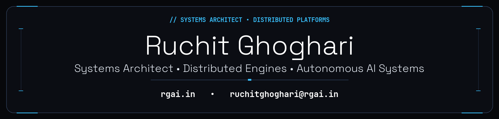

  

---

## ⚡ Executive Summary & Engineering Philosophy

I am a **Lead Systems Architect and Senior Full-Stack Engineer** dedicated to engineering high-concurrency distributed platforms, zero-trust financial transaction engines, and server-authoritative e-commerce ecosystems.

My engineering standard bridges two worlds:
1. **Surgical Relational Architecture:** ACID transaction integrity, integer-paise mathematical precision, PostgreSQL row-level locks, and immutable cryptographic audit ledgers.
2. **Editorial Minimalist Craftsmanship:** Bespoke luxury frontend experiences inspired by Apple Store and Farfetch minimalism, backed by autonomous multi-agent engineering (**RG AI Architecture**).

Targeting Staff / Principal Systems Architect and Lead Engineering opportunities with forward-thinking technology organizations (Google, Microsoft, Meta, Amazon, and enterprise technology innovators).

